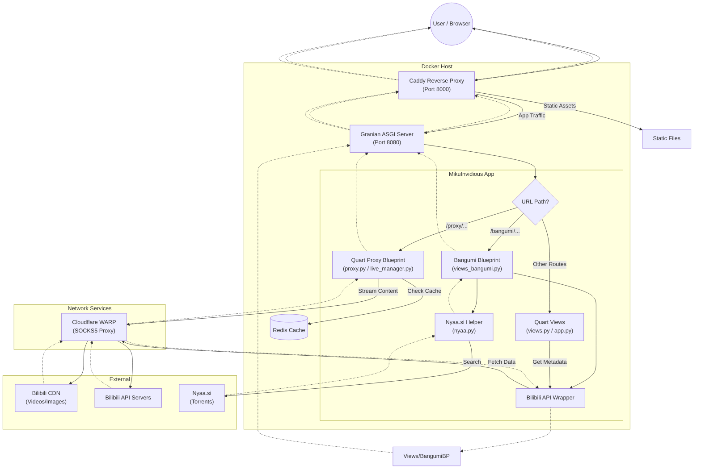

# MikuInvidious Project Overview

MikuInvidious is a free and open-source frontend for Bilibili, inspired by Invidious. It aims to provide a lightweight, privacy-focused experience for browsing Bilibili content without the need for heavy official clients or extensive tracking.

## Core Technologies

- **Language:** Python 3.15+
- **Web Framework:** [Quart](https://pgjones.gitlab.io/quart/) (Modern asynchronous web framework)
- **Web Server:** [Caddy](https://caddyserver.com/) (Reverse proxy) + [Granian](https://github.com/emmett-framework/granian) (ASGI server)
- **Database/Cache:** [Redis](https://redis.io/) (required for caching video URLs, session management, and credential storage)
- **API Wrapper:** Local `python/api/` module (replaces the archived [bilibili-api-python](https://github.com/nemo2011/bilibili-api); migration completed Sep 2 2026)
- **Video Player:** `dash.js` (VOD DASH), `hls.js` (live HLS fmp4 master) + `mpegts.js` (live FLV), native MP4 (progressive fallback)
- **Templating:** Jinja2 (with theme support)

## System Architecture

### High-Level Design

The system uses **Caddy** as a reverse proxy and static file server, which forwards application requests to **Granian** running the **Quart** (ASGI) application. All logic and proxying are handled within the Quart application using asynchronous I/O.

- **Reverse Proxy (Caddy):** Handles incoming traffic (port 8000), serves static assets, and proxies requests to the ASGI server.
- **ASGI Server (Granian):** Runs the Quart application (port 8080 in Docker).
- **App Logic (`app.py`):** Main entry point for the application, registering blueprints and routes.
- **Media Proxy (`proxy.py`, `dash_proxy.py`):** Streams video/images via raw-socket `CdnConnection` (direct, or through WARP SOCKS5 when configured). Uses `ProxyResponse` + `ClosingIterator` to prevent file descriptor leaks.
- **Network Transport:** Optional **Cloudflare WARP** (via SOCKS5) for traffic to Bilibili — required on datacenter IPs (risk-control 412s), unnecessary on residential links (direct fallback).

### Request Flowchart



### Component Breakdown

- **Application Logic:**
  - `app.py`: Initializes the Quart app, error handlers, and registers blueprints.
  - `views.py`: Static re-export facade synchronizing routes and attributes across submodules (`views_home.py`, `views_space.py`, `views_live.py`, `views_video.py`, `views_audio.py`).
    - `views_home.py`: Index, zone feeds, search, history, b23 conversion (`/convert`, `/api/convert`), and licenses views.
    - `views_space.py`: User space, space JSON feed, author profile, and article/opus (`read_view`) routes.
    - `views_live.py`: Live room, categories, and stream views.
    - `views_video.py`: Video detail, related videos, and player components.
    - `views_audio.py`: Audio song, playlist, and audio player routes.
  - `views_bangumi.py`: Blueprint for Bangumi (Anime/Show) indexing and playback.
  - `shared.py`: Centralized configuration, `httpx` client management, Redis connection, and theming utilities.
  - `proxy.py`: Progressive (`/proxy/video/`) + image proxying via `CdnConnection`.
  - `dash_proxy.py`: Canonical DASH static re-export facade across DASH submodules (`dash_common.py`, `dash_fetch.py`, `dash_mpd.py`, `dash_stream.py`, `dash_download_track.py`, `dash_download_job.py`).
    - `dash_common.py`: Constants, types, mirror health/range-shy caches, and helper functions.
    - `dash_fetch.py`: Playurl retrieval, Redis caching, signature freshness, and fallback resolution.
    - `dash_mpd.py`: Dynamic ISO/IEC 23009-1 DASH MPD manifest generation.
    - `dash_stream.py`: HTTP Range track proxying, multi-mirror failover, and body streaming watchdog.
    - `dash_download_track.py`: Segmented track downloading, adaptive pacing, slowdown watchdog, and ffmpeg muxing.
    - `dash_download_job.py`: Download job registry, queue concurrency management, REST API endpoints, and legacy streaming fallback.
  - `live_manager.py`: Manages persistent live stream connections, chunk buffering, and heartbeat (Type 18) injection.
  - `danmaku.py`: Fetches and converts Bilibili danmaku.
  - `nyaa.py`: Scraper and helper for searching Nyaa.si torrents (integrated into Bangumi view).
  - `extra.py`: Utilities for article-to-HTML conversion and ID manipulation.
  - `transformers.py`: Data transformation logic to standardize API responses for the frontend.
  - `filters.py`: Custom Jinja2 template filters (e.g., date formatting).
  - `res.py`: Serves dynamic resources like Danmaku XML.
  - `refresher.py`: Utility to refresh Bilibili credentials.
  - `api/`: Local Bilibili API client.
    - `api/__init__.py`: Exports all public symbols (Credential, video, user, etc.)
    - `api/client.py`: HTTP client with Wbi signing, bili_ticket, auto-cookies, retry logic
    - `api/credential.py`: Credential class for auth
    - `api/exceptions.py`: ArgsException, ResponseCodeException
    - `api/video.py`: Video class (info, tags, related, pages, cid, playurl, danmaku)
    - `api/user.py`: User class (info, videos, articles)
    - `api/search.py`: search_by_type with enums
    - `api/comment.py`: get_comments with enums
    - `api/live.py`: LiveRoom, LiveDanmaku, live_area
    - `api/bangumi.py`: Bangumi class (meta, episodes, index)
    - `api/audio.py`: Audio, AudioList classes
    - `api/article.py`, `api/opus.py`: Article/Opus classes
    - `api/homepage.py`, `api/video_zone.py`: Homepage/zone feeds
    - `data/bangumi_index_params.json`: Copied from bilibili_api package

## Playback & Download Stack

DASH is the canonical VOD path; progressive `durl` remains as a fallback for uploads that have no DASH tracks.

- **DASH fetch** (`api/video.py:get_dash_playurl`, `dash_proxy.py:video_get_dash_for_qn`): wbi playurl with `fnval=4048, fourk=1, qn=120` for UGC, `/pgc/player/web/v2/playurl` fallback for PGC. Cached in Redis as `miku_dash_<vid>_<idx>` (1800s, normalized `base_url`/`backup_url` keys).
- **Manifest** (`dash_proxy.py:generate_vod_mpd`): minimal `isoff-on-demand` MPD at `/video/dash/<vid>/<idx>/manifest.mpd`; only tracks with a valid `SegmentBase.indexRange` are included. BaseURLs point at the track proxy (resolved per-request from cache, never baked in).
- **Track proxy** (`/proxy/dash/<vid>/<idx>/<type>/<qn>/<cid>`): `CdnConnection` (direct, or through WARP when configured); must forward the client `Range` and return `206` + `Content-Range`/`Content-Length`/`Accept-Ranges` (dash.js drives segmentation via sidx itself). Computable lengths are load-bearing for dash.js throughput/ABR/abandon decisions, so `206` responses without a derivable length are skipped as bad mirrors (synthesizing `Content-Length` from `Content-Range` when needed) instead of serving a lengthless stream that ends in "Request timeout: non-computable download size" (dash.js#4716); the player uses a 60s `fragmentRequestTimeout` with the abandon-requests rule explicitly on. Mirrors are tried healthy-first via cross-request sick-mirror memory (transport failures only — 403/412/514 never mark — 120s cooldown, success clears immediately; mid-file 416s from thin edge caches are remembered separately with offset granularity — range-shy, same cooldown — so later fragments skip the doomed mirror instead of burning a failover slot; when every remaining mirror is range-shy but the cutting mirror just served bytes, the remainder is re-requested on the same mirror (bounded, `_SAME_MIRRORS_MAX_RESUMES` — proven partial progress beats certain 416)), max 2 mirrors per fragment with a 4s handshake deadline (`DASH_PLAYBACK_ATTEMPT_TIMEOUT`, `_PLAYBACK_MAX_MIRRORS`): dash.js abandons slow fragments itself (~7s, verified live), so deeper per-request sweeps only outlive client patience — fail fast and let it retry/ABR-downshift. Past the handshake, cuts/errors and 5s no-bytes idle stalls (`DASH_BODY_IDLE_TIMEOUT`) transparently resume the remaining `Range` on the next mirror (byte-contiguous, invisible to dash.js); mere slowness never switches mirrors in playback (backup URLs are for failures — dash.js owns mild slowness via abandon + ABR; only genuine tarpits under the body floor trip server-side, since a big top-quality buffer suppresses abandon urgency and pinned audio has no downshift), while downloads keep the throughput floor + peak-relative trip. Exhausted mirrors return logged `502` (handshake phase) or a truncated stream (body phase, the player re-requests); client abandons are logged with elapsed time and re-raised. 403-swept fragments trigger one fresh-playurl fetch + retry (`_retry_proxy_with_fresh_playurl`, same-stamp dedup); `?fresh=1` on the manifest route forces the same for player recovery.
- **Frontend:** vendored `static/vjs/dash.min.js` (v5.2.1, via `npm run sync:static` from the `dashjs` package — player code must use the v5 representations API, the v4 `getBitrateInfoListFor`/`setQualityFor` no longer exist); `DashPlayerManager` in `static/themes/modern/js/player.js` (retains same-rendition buffer until page exit via `bufferToKeep`, MSE-quota-capped, so seeks never re-fetch watched regions); `api_component_player` passes `is_dash`/`dash_url` to the templates.
- **durl-only fallback** (verified Sep 11 2026): some UGC uploads return a `durl`-only playurl with no `dash` node on every endpoint/param combo. `has_valid_dash_tracks()` gates the DASH path; otherwise `fetch_durl_supported_src()` resolves per-quality progressive URLs (non-wbi playurl + PGC retry, parallel) cached as `mikuinv_<vid>_<idx>_<qn>` (`+_bak` for backups), served by the native `/proxy/video/...` path. Canonical progressive-path fixture: bangumi ep98604 (`BV1Us411h7E4`, S5800E02 — PGC durl-only, UGC -404s it); ancients (aid 2-99) and fresh uploads all carry DASH now, so durl-only UGC is nearly extinct. PGC durl answers every qn with one node, so the resolver keeps exact-qn matches only (else the menu lists one file under four wrong names). Progressive CDN fetches need the web-Chrome UA string (`build_cdn_headers()` — BiliDroid 403s upos/akamaized edges).
- **Download:** `POST /download` with XHR/fetch creates a background job (`create_download_job` in `dash_proxy.py`, max 3 concurrent, unguessable uuid IDs so many users can download at once) and returns `{"job_id"}`; the floating dialog (`static/themes/modern/js/download.js`) polls `GET /download/status/<job>` (percent, `speed_bps`, phases: queued/resolving/downloading/muxing/ready) and auto-saves `GET /download/file/<job>` when ready. Tracks download player-style: video + audio concurrently (like dash.js's two adaptation sets) as 32MB `Range` segments through the same mirror-failover + watchdog machinery, appended to disk (1MB write batches) — each segment rotates its starting mirror (sick trailing, M-CDN last) with an adaptive pacing breather (2/4/6/8/10s ladder on consecutive slow trips since per-IP throttling escalates over sustained fetching and decays with quiet time; clean fast segments reset it), reuses kept-alive connections (no handshake/slow-start restart; banked only after exactly-consumed length-framed bodies), and trips a current-speed slowdown watchdog (fixed 1s windows: 3 consecutive windows under 300KB/s after a ≥1MB/s window proved capability — averages react too slowly and burst-set peaks trip healthy speeds — bounded probes per segment, then patience; slow trips cut the connection and pause a fixed 10s before reconnecting since fresh hammers land back in the penalty box) on top of the absolute floor. Transient cuts back off and resume per segment (unbounded retries until user cancel, backoff plateauing at 16s, surfaced as a status note); segment-exhaustion refreshes the playurl only for dead signatures (403-class sweep or provably-past stamp — never for mere slowness), unbounded with same-stamp dedup. Cancel button / dialog close / pagehide (`sendBeacon`) hits `POST /download/cancel/<job>`, which aborts the CDN fetch, kills ffmpeg, and deletes temp files. DASH videos are muxed (best video track ≤ qn 80 = 1080P anonymous cap + best standard audio, `ffmpeg -c copy -movflags +faststart`; requires `ffmpeg` in the app image). durl-only videos download the progressive MP4 directly (already muxed, no ffmpeg step). Plain form posts keep the legacy `302 /proxy/download/<vid>/<idx>/<qual>` streaming path for no-JS clients.

Remaining work: PGC premium end-to-end verification against a paid episode; `video_listen`/audio migration off durl; deprecated HLS/m3u8 helper cleanup; full live end-to-end test.

## Verified Gotchas (do not regress)

- **DASH CDN requires a web User-Agent.** `.bilivideo.com` returns 403 for the Android app UA (`BiliDroid/...`); `proxy_dash` builds CDN-specific headers (web Chrome UA + `Referer`/`Origin: https://www.bilibili.com` via `python/fingerprints.py`) instead of reusing `get_common_headers()`. See `doc/fingerprints.md` for full profile matrix.
- **Never send the `bili_ticket` cookie to the web API.** It triggers the anti-bot `v_voucher` precheck (empty results, e.g. broken `/search`). Only the `x-bili-ticket` *header* (CDN/DASH proxying) may carry it.
- **Space endpoints are risk-controlled from datacenter IPs** (HTTP 412 / `-352`) without the WARP proxy. `User.get_user_info` falls back to non-wbi `/x/web-interface/card`; `User.get_videos` falls back to `/x/series/recArchivesByKeywords` + `dm_img_*` fingerprint, normalized to the same `list.vlist` shape. Some non-wbi endpoints (`/x/web-interface/view`, danmaku, playurl) also 412 without WARP — IP-level anti-bot responses, not code defects. Space params are bundle-exact (fresh-space `index-*.js`, Oct 2026): `acc/info` = `{mid, token:"", platform:"web", web_location:1550101, x-bili-device-req-json}`; `arc/search` = `{..., order_avoided:"true" (STRING, not bool), platform:"web", web_location:333.1387, special_type:"", index:0, x-bili-device-req-json}` + `dm_img_*` via the `RISK_USER_LOG` middleware pattern (`dm_img_switch:"0"` when KvSDK `payload_log!="1"`; official `@bilibili/bili-user-fingerprint` strips trailing 2 chars from base64 and projects un-scrolled `of` as `[rnd, 2*rnd, rnd]`, see `doc/space_risk_control.md`); fallback key is `orderby` (not `order`). Throttled-but-empty results set `User._degraded` so `/space` renders a banner + `X-Degraded` instead of a silent "0 videos".
- **Streaming routes use long timeouts** (up to 3 hours) to prevent idle drops during long-form content; image proxying uses an aggressive concurrency limit with WebP resizing.
- **Live `getInfoByRoom` requires WBI + browser TLS.** Since ~Aug 2026 Bilibili's web client calls it as `wbiSign({room_id, web_location: "444.8"})`; unsigned httpx requests get `-352` risk control. `api/live.py:get_room_info` therefore uses curl_cffi Chrome impersonation (`_wbi_get`, same pattern as `search.py`/`comment.py`). Other live endpoints (play-info v2, playUrl, danmu, area list) were unaffected; note the area-list `second/getList` and empty play-info `stream[]` from datacenter IPs are IP-level gating (need WARP), not signing issues.
- **Playurl risk gate is `code==0 + data.v_voucher` (player-rewritten `-352`).** Verified Sep 29 2026 against `core.ba67b466.js` (`getGaiaRisk`): `Video._request_playurl` retries once via the avoidance lane (`isGaiaAvoided=true`, `gaia_source=pre-load`, `try_look=1`, `dm_img_*` fingerprint) since there is no captcha UI server-side; `dash_proxy` falls through to PGC when the gate survives. Anonymous playurl uses the `dm_img_*` WebGL-template fingerprint (verified live: `dm_img_switch=0` no-fingerprint mode works but caps anonymous quality at 480p, while the faker returns the full ladder up to 1080p), `web_location=1315873`, and the `x-bili-device-req-json` header; static WBI fallback keys (`4a1d.../fa58...`, from the space fresh-space bundle Oct 2026) cover `/nav` outages.
- **UGC detail endpoints fake-404 PGC BVs under risk control (`-404 啥都木有` from `wbi/view`, `pagelist`, danmaku) while PGC endpoints (`pgc/view/web/season`, `pgc/player/web/playurl`) stay clean.** Playurl resolution must therefore never let UGC cid failure veto the PGC path: `video_get_dash_for_qn`/`_fetch_single_durl` accept a known `cid` (threaded from the season lookup via `pgc_cid`) and still attempt PGC with `ep_id` alone when cid resolution fails.
- **Live format policy is server-side: FLV first, HLS fallback** (`views.py:_pick_live_url`; reversed by `LIVE_PREFER_HLS=true`). The player never switches formats mid-stream; `hls.min.js` loads only on live-HLS pages, `mpegts.js` only on live-FLV pages, and VOD loads neither (FLV is live-only; VOD is DASH/native). The template passes the chosen format as `window.live_format` since HLS master URLs don't always carry an `.m3u8` suffix to sniff.
- **CDN URLs are time-signed (~2h TTL) — refresh means dead signatures, never slowness.** Verified Oct 2026 against a live `__playinfo__` (`deadline=<unix_ts>`, ~2h validity) and the official player bundle (`core.ba67b466.js`: `isUrlExpired()` checks `expires|wsTime|txTime|um_deadline|deadline`; segment errors are keyed off the failed URL's stamp with same-stamp dedup; recovery is backup-URL-then-`prefetchPlayUrl`). Our mirror: `_playurl_url_expiry()` (same five spellings) + proactive staleness drop in `_load_dash_data` + one-shot `_refresh_dash_data` on 403-class sweeps or provably-past stamps (same-stamp declined), shared by playback (`proxy_dash`, `?fresh=1` manifest, frontend segment-error streak → fresh-MPD reconnect capped at 1/10min) and downloads. Never refresh on tarpit exhaustion — new signatures on the same sick edge change nothing.
- **Playback fails fast, downloads persist — by design.** dash.js abandons slow fragments itself (~7s live-observed) with 5 retries + ABR downshift, so per-request heroics beyond 2 mirrors / 4s handshakes only guarantee the client gives up first (wasted work + spins). Downloads have no client intelligence, so they keep the patient budgets (8s handshakes, full sweeps, 5 backoff retries/segment). Do not "unify" the two paths.

## Bilibili API Reference

```
# Video (NO wbi)
GET https://api.bilibili.com/x/web-interface/view
GET https://api.bilibili.com/x/web-interface/view/detail/tag
GET https://api.bilibili.com/x/web-interface/archive/related
GET https://api.bilibili.com/x/player/pagelist
GET https://api.bilibili.com/x/player/playurl

# Video (wbi required)
GET https://api.bilibili.com/x/web-interface/wbi/view/detail
GET https://api.bilibili.com/x/player/wbi/playurl   (UGC canonical; player forces web_location=1315873, fnval=4048, x-bili-device-req-json header)
GET https://api.bilibili.com/x/player/wbi/v2        (subtitle/danmaku meta)

# Playurl endpoint map (player core.*.js getUrl; verified Sep 29 2026)
# Ugc -> x/player/wbi/playurl | Pgc -> pgc/player/web/v2/playurl | Pugv -> pugv/player/web/playurl
GET https://api.bilibili.com/pgc/player/web/v2/playurl

# User (wbi required)
GET https://api.bilibili.com/x/space/wbi/acc/info
GET https://api.bilibili.com/x/space/wbi/arc/search
GET https://api.bilibili.com/x/space/wbi/article

# Search (wbi required)
GET https://api.bilibili.com/x/web-interface/wbi/search/type

# Comment
GET https://api.bilibili.com/x/v2/reply/main

# Live
GET https://api.live.bilibili.com/xlive/web-room/v1/index/getInfoByRoom
GET https://api.live.bilibili.com/xlive/web-room/v2/index/getRoomPlayInfo
GET https://api.live.bilibili.com/xlive/web-room/v1/playUrl/playUrl
GET https://api.live.bilibili.com/xlive/web-interface/v1/second/getList

# Bangumi
GET https://api.bilibili.com/pgc/review/user
GET https://api.bilibili.com/pgc/web/season/section
GET https://api.bilibili.com/pgc/season/index/result
GET https://api.bilibili.com/pgc/view/web/season

# Audio
GET https://www.bilibili.com/audio/music-service-c/web/song/info
GET https://www.bilibili.com/audio/music-service-c/web/url
GET https://www.bilibili.com/audio/music-service-c/web/menu/info
GET https://www.bilibili.com/audio/music-service-c/web/song/of-menu

# Article & Opus
GET https://api.bilibili.com/x/article/viewinfo
GET https://api.bilibili.com/x/polymer/web-dynamic/v1/opus/detail

# Homepage (wbi required)
GET https://api.bilibili.com/x/web-interface/wbi/index/top/feed/rcmd

# Wbi & Auth
GET https://api.bilibili.com/x/web-interface/nav  (for wbi mixin key)
POST https://api.bilibili.com/bapis/bilibili.api.ticket.v1.Ticket/GenWebTicket  (for bili_ticket)
```

### Wbi Signing Algorithm

```
1. GET /x/web-interface/nav -> extract wbi_img.img_url + wbi_img.sub_url
2. Take filenames, concat, apply OE permutation table -> 32-char mixin_key
3. For each request: add wts=unix_ts, sort params, urlencode, append mixin_key, MD5 -> w_rid
4. Retry on -403: clear mixin_key cache, re-fetch from nav, re-sign
```

### bili_ticket Algorithm

```
1. HMAC-SHA256(key="XgwSnGZ1p", message=f"ts{int(time.time())}")
2. POST /bapis/bilibili.api.ticket.v1.Ticket/GenWebTicket with hexsign + key_id=ec02
3. Extract data.ticket from response
4. Cache for 3 days
```

## Infrastructure (Docker)

The production infrastructure consists of four orchestrated services defined in `compose.yml`:

| Service | Image | Description |
| :--- | :--- | :--- |
| **`app`** | *(Local Build)* | Granian running the Quart application. Exposes port `8080` internally. |
| **`caddy`** | `caddy:alpine` | Reverse proxy and static asset server. Exposes port `8000`. |
| **`redis`** | `redis:alpine` | Persists sessions and caches API responses. |
| **`warp`** | `caomingjun/warp` | SOCKS5 proxy (port `1080`) for Bilibili API/CDN traffic. Optional — only needed on datacenter IPs; residential links connect directly. |

The `Dockerfile` builds a clean Alpine runtime containing `ffmpeg`.

## Configuration

Configuration is managed via `config.toml` (recommended) or Environment Variables.

- **`[site]`**: Metadata, Robots policy, and source code link. `site_url` defaults to `http://localhost:8888` (preventing session cookies from being dropped in local HTTP development). Session cookie `Secure` flag dynamically derives from `site_url.startswith("https://")`, and cookies enforce `SameSite=Lax`. Setting the `SITE_URL` environment variable explicitly overrides `config.toml` `site_url`.
- **`[server]`**: Host and port settings (Default: 8888 for manual run), plus `access_log`/`SERVER_ACCESS_LOG` (Granian per-request access log, default off — it buries app logs at one line per segment/image/poll).
- **`[credential]`**: Bilibili cookies (SESSDATA, etc.) for authenticated access.
- **`[proxy]`**: Global toggle for media proxying.
- **`[redis]`**: Redis connection details.
- **`[cache]`**: Response cache TTLs, all env-configurable in minutes (`0` disables): `space_minutes`/`SPACE_CACHE_MINUTES` (5), `space_json_minutes`/`SPACE_JSON_CACHE_MINUTES` (5), `video_minutes`/`VIDEO_CACHE_MINUTES` (15), `bangumi_minutes`/`BANGUMI_CACHE_MINUTES` (60), `author_minutes`/`AUTHOR_CACHE_MINUTES` (30), `article_minutes`/`ARTICLE_CACHE_MINUTES` (30), `audio_minutes`/`AUDIO_CACHE_MINUTES` (30), `home_minutes`/`HOME_CACHE_MINUTES` (30). `/space/<mid>` (page 1) and `/space/<mid>/json` share one upstream payload (`space:data:<mid>`); deeper space/author pages use per-page keys (`space:data:<mid>:<pn>`); video/audio/article routes cache upstream data while comments stay live; only healthy payloads are cached, so transient failures are never stuck in cache. All cached pages emit `X-Cache: HIT/MISS`.
- **`[render]`**: Configuration for article rendering (Pandoc support).

## Development & Deployment

### Docker Deployment (Recommended)

1. **Run with Docker Compose:**

    ```bash
    docker-compose up -d --build
    ```

2. **Access:** `http://localhost:8000`

### Manual Development Setup

1. **Prerequisites:** Python 3.15+, Redis server running.
2. **Install Python Dependencies:**

    ```bash
    uv sync
    ```

3. **Run:**

    ```bash
    uv run python/main.py
    ```

    Access at `http://localhost:8888` (or configured port).

### Code Quality, Linting & Verification

Run verification before committing changes. Prefer direct `uv` commands; only invoke `npm` when necessary (e.g., when frontend assets, styles, vendored dependencies, or templates are modified).

- **Run Test Suite (Python - preferred, no npm):**
  ```bash
  PYTHONPATH=python uv run python -m unittest discover tests
  ```
  Or `npm test` if npm is already in use.

- **Bytecode Compilation Check (Syntax & Import Errors):**
  ```bash
  uv run python -m compileall -f python tests tools
  ```

- **Python Linting & Formatting:**
  ```bash
  uv run ruff check python
  uv run ruff format python
  ```

- **Frontend Linting & Formatting (Only when frontend JS/CSS/templates are modified):**
  ```bash
  npm run lint:frontend
  npm run format:frontend
  ```
  Or `npm run lint` / `npm run format` for full multi-language checks when both Python and frontend changed.

- **CSS & Static Asset Sync (Only when styles or vendored libraries are modified):**
  ```bash
  npm run build:css     # when static/themes/modern/css/tailwind-input.css changes
  npm run sync:static   # when bumping vendored packages in package.json
  ```

- **i18n Verification (When translatable strings change):**
  ```bash
  npm run check:i18n
  npm run build:i18n  # regenerate if catalogs are stale
  ```

### Continuous Integration & Security Auditing

- **CI Pipeline (`.github/workflows/ci.yml`):** Runs on Python 3.15, validates test suites, multi-language linting, and bytecode compilation. Scoped to primary branches with concurrency cancellation to prevent duplicate runs on PR branches.
- **Security Auditing (`.github/workflows/review.yml`):** Runs automated security vulnerability checks using `pip-audit` and `npm-audit`.
- **Dependabot (`.github/dependabot.yml`):** Configured for GitHub Actions, npm, and pip/uv dependency updates.

## Development Conventions

- **License:** GNU AGPL-3.0.
- **Theming:** Templates in `templates/themes/`. Current active theme is `modern` (Tailwind CSS, light/dark, mobile-first).
- **Static Assets:** `static/` contains `hls.js`, `mpegts.js`, `dash.min.js`, and `danmaku.js`.
- **Proxying Strategy:**
  - **Images:** Always proxied with WebP optimization.
  - **Videos:** Always proxied via `CdnConnection` (raw socket; direct, or WARP SOCKS5 when configured).
- **B23.tv:** Short links are resolved server-side.
