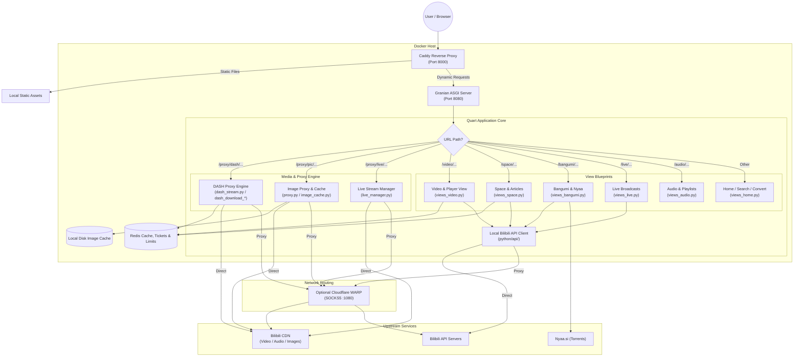

# MikuInvidious Architecture & System Design

MikuInvidious is an asynchronous, privacy-first web frontend and media proxy for Bilibili, implemented in Python 3.15+ using Quart, Granian, Caddy, Redis, and optional Cloudflare WARP.

---

## 1. High-Level Design

```
+-------------------------------------------------------------+
| Browser / User Client                                       |
+-------------------------------------------------------------+
                              |
                              v Port 8000
+-------------------------------------------------------------+
| Caddy Reverse Proxy & Static Asset Server                   |
| - Serves /static/* directly                                 |
| - Proxies application traffic to Granian ASGI (:8080)       |
+-------------------------------------------------------------+
                              |
                              v Port 8080
+-------------------------------------------------------------+
| Granian ASGI Server (Quart Application)                     |
|                                                             |
| +---------------------------------------------------------+ |
| | Middleware Layer                                        | |
| | - Rate Limiter (rate_limit.py, Redis-backed)            | |
| | - CSRF Protection (csrf.py)                             | |
| | - Internationalization (i18n.py)                        | |
| +---------------------------------------------------------+ |
|                                                             |
| +---------------------------------------------------------+ |
| | Routing & View Blueprints (views_*.py, app.py)          | |
| | - Home, Search, Feeds (views_home.py)                   | |
| | - Video Details & Player (views_video.py)               | |
| | - User Space & Articles (views_space.py)                | |
| | - Bangumi / Anime Index & Nyaa (views_bangumi.py)       | |
| | - Live Room & Format Selector (views_live.py)           | |
| | - Audio & Playlists (views_audio.py)                    | |
| +---------------------------------------------------------+ |
|                                                             |
| +---------------------------------------------------------+ |
| | Media & Streaming Engine                                | |
| | - DASH Engine: MPD, Fetch, Stream, Download             | |
| |   (dash_mpd, dash_fetch, dash_stream, dash_download_*)  | |
| | - Image Proxy & Disk LRU Cache (proxy.py, image_cache)  | |
| | - Progressive Proxy & Live Manager (proxy.py, live_mgr) | |
| | - Raw Sockets & TLS Context (stream.py, CdnConnection)  | |
| +---------------------------------------------------------+ |
|                                                             |
| +---------------------------------------------------------+ |
| | Upstream Bilibili Client (python/api/)                  | |
| | - WBI Signatures, bili_ticket, Gaia avoidance           | |
| | - Video, User, Live, Bangumi, Audio, Article wrappers   | |
| +---------------------------------------------------------+ |
+-------------------------------------------------------------+
          |                         |
          v                         v
+------------------+      +-------------------------------+
| Redis Server     |      | Outbound Transport            |
| - Page Caching   |      | - Direct Residential          |
| - Ticket Storage |      | - Cloudflare WARP SOCKS5:1080 |
| - Rate Limiting  |      |   (for Datacenter IPs)        |
+------------------+      +-------------------------------+
                                    |
                                    v
                          +-------------------------------+
                          | Upstream Bilibili CDN & APIs  |
                          +-------------------------------+
```

> [!NOTE]
> Quart manages user sessions entirely via signed client-side cookies (`SecureCookieSessionInterface`), not in Redis. Flushing Redis alone does not invalidate existing user session cookies while the application is running.

---

## 2. Request Flowchart



---

## 3. Comprehensive Module Inventory (`python/`)

### Application Core & Configuration
- **`app.py`**: Initializes the Quart application, configures security headers, registers error handlers, and attaches all blueprints.
- **`main.py`**: Local development launcher wrapping the Granian ASGI server.
- **`shared.py`**: Central system configuration (`appconf`), Redis pool manager (`appredis`), HTTP connection pools (`Network`), proxy configuration, and image concurrency semaphores.
- **`csrf.py`**: Token generation, validation, and session binding for mutating requests.
- **`rate_limit.py`**: Sliding-window Redis rate limiter with IP validation and CIDR proxy header inspection.
- **`secrets_encryption.py`**: Encrypts and decrypts sensitive credentials at rest using libsodium XChaCha20-Poly1305.
- **`i18n.py` & `i18n_strings.py`**: Internationalization engine providing locale resolution and translation catalog bindings.

### Views & Presentation Layer
- **`views.py`**: Static re-export facade exposing route handlers across views.
- **`views_home.py`**: Index feed, search endpoints, zone categories, history, licenses, and `/convert` B23 resolution.
- **`views_video.py`**: Video metadata rendering, multi-part page lists, related content, and inline player components.
- **`views_space.py`**: User space profiles, video archives, JSON feeds (`/space/<mid>/json`), and article views.
- **`views_bangumi.py`**: Anime, movies, and documentary seasons, episode indexing, and Nyaa.si torrent integration.
- **`views_live.py`**: Live stream rooms, server-side format selection (FLV/HLS), and category navigation.
- **`views_audio.py`**: Audio song playback, playlists, and audio player templates.
- **`filters.py`**: Jinja2 presentation filters for human-readable timestamps, byte sizes, and duration formatting.
- **`transformers.py`**: Data normalization layer standardizing upstream API responses for template consumption.
- **`res.py`**: Serves dynamic auxiliary assets like Danmaku XML and server-side redirects.

### Media Streaming & DASH Pipeline
- **`dash_proxy.py`**: Central re-export facade for DASH VOD and downloads.
- **`dash_common.py`**: Core data structures, playback mirror health tracking, and range-shy cache.
- **`dash_fetch.py`**: Fetches playurls, caches normalized tracks in Redis, and manages dual-layer in-memory fallback.
- **`dash_mpd.py`**: Generates dynamic ISO/IEC 23009-1 DASH manifests (`manifest.mpd`).
- **`dash_stream.py`**: HTTP Range track proxying, multi-mirror failover, watchdog, and upstream socket reuse (`_PlaybackKeepAlivePool`).
- **`dash_download_track.py`**: Segmented background track downloader with adaptive pacing ladders and ffmpeg muxing.
- **`dash_download_job.py`**: Download queue concurrency controller and status polling REST endpoints.
- **`proxy.py`**: Progressive media streaming (`/proxy/video/`) and image proxying (`/proxy/pic/`).
- **`image_cache.py`**: High-performance disk-based LRU image cache with automatic capacity pruning.
- **`stream.py`**: Raw TCP socket helpers with persistent `_TLS_CONTEXT` for low-latency streaming.
- **`live_manager.py`**: Persistent live stream connection buffering and heartbeat injection.
- **`dns_cache.py`**: Async stale-while-revalidate DNS resolver preventing SSRF attacks and inline latency spikes.
- **`danmaku.py`**: Fetches, decodes protobuf, and converts Bilibili live/video danmaku.
- **`b23_resolver.py`**: Resolves `b23.tv` short links server-side to prevent client tracking.
- **`ip_slots.py`**: Concurrency controller balancing outbound requests across IP pools.
- **`refresher.py` & `ticket_legacy.py`**: Upstream credential and web ticket refresh maintenance.

### Local API Wrapper (`python/api/`)
- **`api/client.py`**: Core HTTP client implementing WBI query signing, `bili_ticket` generation, auto-cookies, and Gaia risk mitigation.
- **`api/credential.py`**: Credential state container (`SESSDATA`, `bili_jct`, `buvid3`, `buvid4`, `dedeuserid`).
- **`api/video.py`**: Video metadata, tags, cid resolution, playurls (DASH + progressive), and subtitles.
- **`api/user.py`**: Space profiles, author video archives, and articles.
- **`api/live.py` & `api/live_area.py`**: Live room metadata, stream URLs, live danmaku, and category taxonomy.
- **`api/bangumi.py`**: PGC seasons, episodes, and index exploration.
- **`api/search.py`**: Unified multi-category search.
- **`api/comment.py`**: Video and article discussion threads.
- **`api/audio.py`**: Music tracks and audio playlists.
- **`api/article.py` & `api/opus.py`**: Text articles and dynamic opus posts.
- **`api/homepage.py` & `api/video_zone.py`**: Trending home feeds and sub-channel feeds.
- **`api/exceptions.py`**: Structured upstream exception hierarchy.
