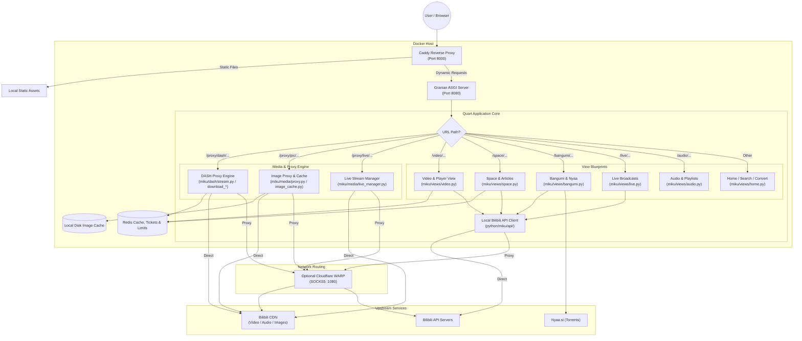

<!-- coderabbit-ai-generated:v1 -->

<!-- coderabbit-ai-generated-section:v1:be41861ff6654c7d055a85ad3ad2b34c8d8d7f972ae7d1561d6ece986c179e3b -->

# MikuInvidious Architecture & System Design

MikuInvidious is an asynchronous, privacy-first web frontend and media proxy for Bilibili, implemented in Python 3.15+ using Quart, Granian, Caddy, Redis, and optional Cloudflare WARP.

---

## 1. High-Level Design

```
+-------------------------------------------------------------+
| Browser / User Client                                       |
+-------------------------------------------------------------+
                              |
                              v Port 8000
+-------------------------------------------------------------+
| Caddy Reverse Proxy & Static Asset Server                   |
| - Serves /static/* directly                                 |
| - Proxies application traffic to Granian ASGI (:8080)       |
+-------------------------------------------------------------+
                              |
                              v Port 8080
+-------------------------------------------------------------+
| Granian ASGI Server (Quart Application)                     |
|                                                             |
| +---------------------------------------------------------+ |
| | Middleware Layer                                        | |
| | - Rate Limiter (miku/core/rate_limit.py, Redis-backed)  | |
| | - CSRF Protection (miku/core/csrf.py)                   | |
| | - Internationalization (miku/ui/i18n.py)                | |
| +---------------------------------------------------------+ |
|                                                             |
| +---------------------------------------------------------+ |
| | Routing & View Blueprints (miku/views/*.py, miku/app.py)| |
| | - Home, Search, Feeds (miku/views/home.py)              | |
| | - Video Details & Player (miku/views/video.py)          | |
| | - User Space & Articles (miku/views/space.py)           | |
| | - Bangumi / Anime Index & Nyaa (miku/views/bangumi.py)  | |
| | - Live Room & Format Selector (miku/views/live.py)      | |
| | - Audio & Playlists (miku/views/audio.py)               | |
| +---------------------------------------------------------+ |
|                                                             |
| +---------------------------------------------------------+ |
| | Media & Streaming Engine (miku/dash/, miku/media/)      | |
| | - DASH Engine: MPD, Fetch, Stream, Download             | |
| |   (mpd, fetch, stream, download_*)                      | |
| | - Image Proxy & Disk LRU Cache (proxy.py, image_cache)  | |
| | - Progressive Proxy & Live Manager (proxy.py, live_mgr) | |
| | - Raw Sockets & TLS Context (stream.py, CdnConnection)  | |
| +---------------------------------------------------------+ |
|                                                             |
| +---------------------------------------------------------+ |
| | Upstream Bilibili Client (python/miku/api/)             | |
| | - WBI Signatures, bili_ticket, Gaia avoidance           | |
| | - Video, User, Live, Bangumi, Audio, Article wrappers   | |
| +---------------------------------------------------------+ |
+-------------------------------------------------------------+
          |                         |
          v                         v
+------------------+      +-------------------------------+
| Redis Server     |      | Outbound Transport            |
| - Page Caching   |      | - Direct Residential          |
| - Ticket Storage |      | - Cloudflare WARP SOCKS5:1080 |
| - Rate Limiting  |      |   (for Datacenter IPs)        |
+------------------+      +-------------------------------+
                                    |
                                    v
                          +-------------------------------+
                          | Upstream Bilibili CDN & APIs  |
                          +-------------------------------+
```

> [!NOTE]
> Quart manages user sessions entirely via signed client-side cookies (`SecureCookieSessionInterface`), not in Redis. Flushing Redis alone does not invalidate existing user session cookies while the application is running.

---

## 2. Request Flowchart



---

## 3. Comprehensive Module Inventory (`python/`)

### Industrial Core Package (`python/miku/`)
- **`miku.core.app`**: Standardized application factory (`create_app()`) configuring Quart, template/static paths, JSON providers, timeout ceilings, and session security.
- **`miku.core.config`**: Decoupled TOML configuration loader supporting environment overrides (`MIKU_*`), version extraction, and dynamic config paths.
- **`miku.services.redis`**: Fast-fail Redis connection pool factory enforcing a strict 1.0s socket timeout and 0 automatic retries to prevent event loop exhaustion.
- **`miku.services.cache`**: Unified cache get/set/stale operations and singleflight-protected caching decorators.
- **`miku.services.network`**: Global HTTPX async client connection pool lifecycle with connection pooling and proxy support.
- **`miku.services.ticket`**: Thread-safe, singleflight-coalesced Bilibili ticket lifecycle, isolation (CDN headers only, never cookies), and storage.
- **`miku.services.credential`**: Sensitive credential decryption at rest using libsodium SecretBox (XSalsa20-Poly1305).
- **`miku.ui.renderer`**: Theme resolution, theme cookie parsing, and fallback template rendering context.
- **`miku.ui.sanitizer`**: Modern HTML sanitization with `nh3` (Ammonia) preventing XSS on articles and rich user content.
- **`miku.api.wbi`**: Dedicated WBI key calculation, mixin derivation, and query signing.
- **`miku.api.bvid`**: Modern PipePipe BV/AV conversion algorithm.

### Application Core & Configuration
- **`miku/app.py`**: Initializes the Quart application instance and registers middleware, blueprints, and error handlers.
- **`python/main.py`**: Granian ASGI production launcher pinned to 1 worker for in-memory download consistency.
- **`miku/state.py`**: Shared singleton runtime state (`appredis`, HTTPX client, template renderer).
- **`miku/core/config.py` & `miku/core/app.py`**: Configuration loading, Quart defaults/timeouts, and app factory helpers.
- **`miku/services/concurrency.py`**: Cancellation-safe generic `Singleflight[T]` preventing duplicate in-flight requests and thundering herds.
- **`miku/api/bvid.py`**: Canonical BVID/AVID converter supporting both integer and string IDs.
- **`miku/core/csrf.py`**: Token generation, validation, and session binding for mutating requests.
- **`miku/core/rate_limit.py`**: Sliding-window Redis rate limiter with IP validation and CIDR proxy header inspection.
- **`miku/ui/i18n.py` & `miku/ui/i18n_strings.py`**: Internationalization engine providing locale resolution and translation catalog bindings.

### Views & Presentation Layer
- **`miku.views`**: Non-wildcard re-export facade with PEP 562 dynamic attribute resolution.
- **`miku/views/home.py`**: Index feed, search endpoints, zone categories, history, licenses, and `/convert` B23 resolution.
- **`miku/views/video.py`**: Video metadata rendering, multi-part page lists, related content, and inline player components.
- **`miku/views/space.py`**: User space profiles, video archives, JSON feeds (`/space/<mid>/json`), and article views.
- **`miku/views/bangumi.py`**: Anime, movies, and documentary seasons, episode indexing, and Nyaa.si torrent integration.
- **`miku/views/live.py`**: Live stream rooms, server-side format selection (FLV/HLS), and category navigation.
- **`miku/views/audio.py`**: Audio song playback, playlists, and audio player templates.
- **`miku/ui/filters.py`**: Jinja2 presentation filters for human-readable timestamps, byte sizes, and duration formatting.
- **`miku/media/transformers.py`**: Data normalization layer standardizing upstream API responses for template consumption.
- **`miku/media/res.py`**: Serves dynamic auxiliary assets like Danmaku XML and server-side redirects.

### Media Streaming & DASH Pipeline
- **`miku.dash`**: Explicit, non-polluting re-export facade for DASH VOD and downloads.
- **`miku/dash/common.py`**: Core data structures, playback mirror health tracking, and range-shy cache.
- **`miku/dash/fetch.py`**: Fetches playurls, caches normalized tracks in Redis, and manages dual-layer in-memory fallback.
- **`miku/dash/mpd.py`**: Generates dynamic ISO/IEC 23009-1 DASH manifests (`manifest.mpd`).
- **`miku/dash/stream.py`**: HTTP Range track proxying, multi-mirror failover, watchdog, and upstream socket reuse (`_PlaybackKeepAlivePool`).
- **`miku/dash/download_track.py`**: Segmented background track downloader with adaptive pacing ladders and ffmpeg muxing.
- **`miku/dash/download_job.py`**: Download queue concurrency controller and status polling REST endpoints.
- **`miku/media/proxy.py`**: Progressive media streaming (`/proxy/video/`) and image proxying (`/proxy/pic/`).
- **`miku/media/image_cache.py`**: High-performance disk-based LRU image cache with automatic capacity pruning.
- **`miku/media/stream.py`**: Raw TCP socket helpers with persistent `_TLS_CONTEXT` for low-latency streaming.
- **`miku/media/live_manager.py`**: Persistent live stream connection buffering and heartbeat injection (stripped of dead ML code).
- **`miku/core/dns_cache.py`**: Async stale-while-revalidate DNS resolver preventing SSRF attacks and inline latency spikes.
- **`miku/media/danmaku.py`**: Fetches, decodes protobuf, and converts Bilibili live/video danmaku.
- **`miku/media/b23_resolver.py`**: Resolves `b23.tv` short links server-side to prevent client tracking.
- **`miku/core/ip_slots.py`**: Concurrency controller balancing outbound requests across IP pools.
- **`miku/media/refresher.py`**: Upstream credential and web ticket refresh maintenance.

### Local API Wrapper (`python/miku/api/`)
- **`miku.api.client`**: Core HTTP client implementing singleflight-guarded cookies, `bili_ticket` generation, auto-cookies, and Gaia risk mitigation.
- **`miku/api/credential.py`**: Credential state container (`SESSDATA`, `bili_jct`, `buvid3`, `buvid4`, `dedeuserid`).
- **`miku/api/video.py`**: Video metadata, tags, cid resolution, playurls (DASH + progressive), and subtitles.
- **`miku/api/user.py`**: Space profiles, author video archives, and articles.
- **`miku/api/live.py` & `miku/api/live_area.py`**: Live room metadata, stream URLs, live danmaku, and category taxonomy.
- **`miku/api/bangumi.py`**: PGC seasons, episodes, and index exploration.
- **`miku/api/search.py`**: Unified multi-category search.
- **`miku/api/comment.py`**: Video and article discussion threads.
- **`miku/api/audio.py`**: Music tracks and audio playlists.
- **`miku/api/article.py` & `miku/api/opus.py`**: Text articles and dynamic opus posts.
- **`miku/api/homepage.py` & `miku/api/video_zone.py`**: Trending home feeds and sub-channel feeds.
- **`miku/api/exceptions.py`**: Structured upstream exception hierarchy.


<!-- /coderabbit-ai-generated:v1 -->