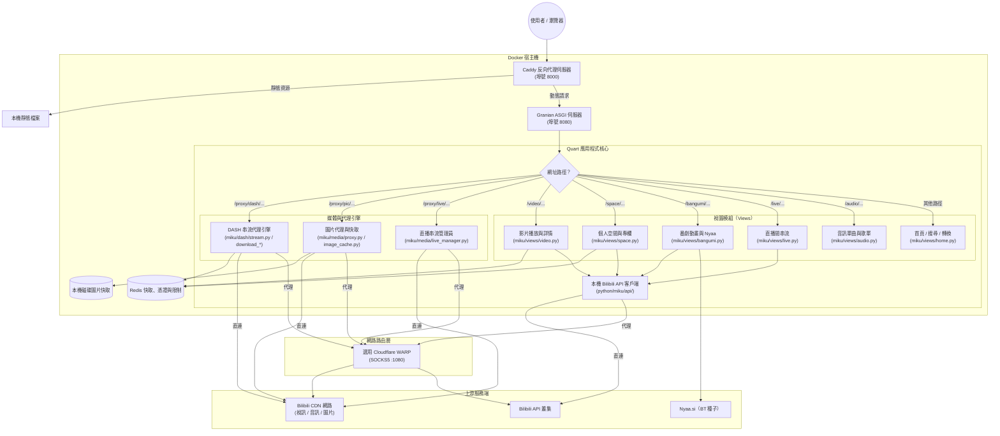

# 系統架構與設計

MikuInvidious 是一套非同步、隱私優先的 Bilibili 網頁前端與媒體代理伺服器，採用 Python 3.15+ 基於 Quart、Granian、Caddy、Redis 與選用 Cloudflare WARP 構建。

---

## 1. 宏觀架構設計

```
+-------------------------------------------------------------+
| 瀏覽器 ／ 客戶端                                            |
+-------------------------------------------------------------+
                              |
                              v 埠號 8000
+-------------------------------------------------------------+
| Caddy 反向代理與靜態資源伺服器                              |
| - 以 file_server 直接提供 /static/* 靜態資源                |
| - 將應用程式流量轉發至 Granian ASGI（:8080）                |
+-------------------------------------------------------------+
                              |
                              v 埠號 8080
+-------------------------------------------------------------+
| Granian ASGI 伺服器（Quart 應用程式）                       |
|                                                             |
| +---------------------------------------------------------+ |
| | 中介軟體層（Middleware）                                | |
| | - 速率限制器（miku/core/rate_limit.py，Redis 權杖桶）   | |
| | - CSRF 防禦（miku/core/csrf.py）                        | |
| | - 多國語系引擎（miku/ui/i18n.py）                       | |
| +---------------------------------------------------------+ |
|                                                             |
| +---------------------------------------------------------+ |
| | 路由與視圖藍圖（miku/views/*.py, miku/app.py）          | |
| | - 首頁、搜尋、分區推薦（miku/views/home.py）            | |
| | - 影片資訊與播放器頁（miku/views/video.py）             | |
| | - 個人空間與文章專欄（miku/views/space.py）             | |
| | - 番劇動畫與 Nyaa 種子（miku/views/bangumi.py）         | |
| | - 直播間與格式選擇（miku/views/live.py）                | |
| | - 音訊單曲與歌單（miku/views/audio.py）                 | |
| +---------------------------------------------------------+ |
|                                                             |
| +---------------------------------------------------------+ |
| | 媒體串流與代理引擎（miku/dash/, miku/media/）           | |
| | - DASH 引擎：MPD、拉取、串流、下載                      | |
| |   (mpd, fetch, stream, download_*)                      | |
| | - 圖片代理與本機 LRU 磁碟快取 (proxy.py, image_cache)   | |
| | - 漸進式代理與直播管理 (proxy.py, live_mgr)             | |
| | - 原生 Socket 與持久化 TLS 上下文 (stream.py, CdnConn)  | |
| +---------------------------------------------------------+ |
|                                                             |
| +---------------------------------------------------------+ |
| | 上游 Bilibili 客戶端封裝（python/miku/api/）            | |
| | - WBI 簽名、bili_ticket 憑證、Gaia 風控規避             | |
| | - 影片、使用者、直播、番劇、音訊與文章模組              | |
| +---------------------------------------------------------+ |
+-------------------------------------------------------------+
          |                         |
          v                         v
+------------------+      +-------------------------------+
| Redis 伺服器     |      | 外部輸出傳輸                  |
| - 頁面快取       |      | - 直接家用寬頻連線            |
| - 時效 Ticket    |      | - Cloudflare WARP SOCKS5:1080 |
| - 速率限制       |      |   (針對資料中心 IP 風控)      |
+------------------+      +-------------------------------+
                                    |
                                    v
                          +-------------------------------+
                          | 上游 Bilibili CDN 與 API 服務 |
                          +-------------------------------+
```

> [!NOTE]
> Quart 透過具數位簽章的客戶端 Cookie（`SecureCookieSessionInterface`）完全管理使用者工作階段，**不儲存在 Redis 中**。`miku.core.app.create_app()` 會優先使用 `[server].secret_key`（或 `QUART_SECRET_KEY`）；若未設定，則於每次啟動時隨機產生一組暫態 32 位元組金鑰（`os.urandom(32).hex()`）。僅清除 Redis 資料庫絕不會影響現有使用者的登入 Cookie。

---

## 2. 壯麗的請求流程圖



---

## 3. 模組完整清單（`python/miku/`）

### 應用程式核心與服務

- **`python/main.py`**：Granian ASGI 啟動入口（`miku.app:app`）。
- **`miku/app.py`**：初始化 Quart 應用、配置安全標頭、註冊全域例外處理器並掛載藍圖。
- **`miku/state.py`**：全域共用執行期狀態（`appredis`、HTTPX 客戶端、範本渲染器）。
- **`miku/core/config.py` 與 `miku/core/app.py`**：系統組態載入（`appconf`）與 Quart 應用工廠（`create_app()`）。
- **`miku/services/`**：Redis 連線池（`redis.py`）、HTTP 客戶端與代理（`network.py`）、快取（`cache.py`）、併發信號量（`concurrency.py`）、憑證管理（`credential.py`）與 `bili_ticket` 生命週期（`ticket.py`）。
- **`miku/core/csrf.py`**：針對狀態變更請求生成並驗證 CSRF 權杖。
- **`miku/core/rate_limit.py`**：基於 Redis 權杖桶的滑動視窗速率限制器，支援 CIDR 信任代理標頭解析（不再隱式信任私有網路）。
- **`miku/core/secrets_encryption.py`**：透過 libsodium XSalsa20-Poly1305 對靜態設定檔中的敏感憑證進行加解密。
- **`miku/ui/`（`i18n.py`、`i18n_strings.py`、`filters.py`、`renderer.py`、`sanitizer.py`）**：語系解析、翻譯字典、Jinja2 過濾器、主題渲染與 HTML 淨化。

### 視圖與介面呈現層（`miku/views/`）

- **`miku/views/__init__.py`**：藍圖註冊外觀模組，彙整並導出所有子視圖藍圖。
- **`miku/views/home.py`**：首頁推薦動態、全站搜尋、分區導覽、觀看歷史、開源授權宣告與 `/convert` 短網址去追蹤解析。
- **`miku/views/video.py`**：影片中繼資料、多 P 分集清單、相關影片推薦與內嵌播放器組件。
- **`miku/views/space.py`**：創作者空間主頁、影片存檔、JSON 訂閱端點（`/space/<mid>/json`）與專欄文章。
- **`miku/views/bangumi.py`**：動畫、影劇季番頁面、集數索引與 Nyaa.si BT 種子聚合。
- **`miku/views/live.py`**：直播間串流房間、伺服器端格式選擇（FLV / HLS）與分區導覽。
- **`miku/views/audio.py`**：音樂單曲播放頁面、專輯歌單與播放器視圖。
- **`miku/media/transformers.py`**：資料規格化轉換層，將上游 API 異質回應清洗為前端範本所需結構。
- **`miku/media/res.py`**：提供即時彈幕 XML 轉換與伺服器端重導向資源。

### 媒體串流與 DASH 管線（`miku/dash/` 與 `miku/media/`）

- **`miku/dash/__init__.py`**：DASH 隨選視訊與背景下載套件導出外觀。
- **`miku/dash/common.py`**：核心資料結構、鏡像節點健康度計數器與 Range 敏感節點標記。
- **`miku/dash/fetch.py`**：抓取播放串流連結、在 Redis 中標準化快取並管理 L1 記憶體 LRU 快取。
- **`miku/dash/mpd.py`**：動態生成符合 ISO/IEC 23009-1 標準之 DASH 清單（`manifest.mpd`）。
- **`miku/dash/stream.py`**：HTTP Range 分段串流代理、多鏡像自動容錯、停滯看門狗與 Socket 連線複用池（`_PlaybackKeepAlivePool`）。
- **`miku/dash/download_track.py`**：分段背景下載器，搭載自適應降速階梯與 ffmpeg 無損音視訊封裝。
- **`miku/dash/download_job.py`**：下載佇列併發排程器與狀態查詢 REST API。
- **`miku/media/proxy.py`**：漸進式媒體串流（`/proxy/video/`）、伺服器端直播 HLS 代理（`/proxy/live_hls`）與經 HMAC 驗證之圖片代理（`/proxy/pic/s/<sig>/...`），具備有界 404 負向快取、單飛合併請求與 HTTP/2 分波鏡像重試。
- **`miku/core/singleflight.py`**：共用的事件迴圈層級取消安全 `SingleflightGroup` 與 `BoundedNegativeCache`，用於媒體代理與冷快取視圖路徑。
- **`miku/core/url_signing.py`**：衍生自 `app.secret_key` 的無狀態 HMAC-SHA256 網址簽章與驗證，保護 `/proxy/pic/`、`/proxy/live_hls`、`/res/danmaku/`、`/res/subtitle/`、`/video/dash/.../manifest.mpd` 與 `/proxy/dash/`。
- **`miku/media/image_cache.py`**：高效能本機磁碟 LRU 圖片快取，具備容量自動修剪功能。
- **`miku/media/stream.py`**：原生 TCP Socket 輔助程式，搭配全域持久化 `_TLS_CONTEXT`。
- **`miku/media/live_manager.py`**：直播串流長連線管理與定時心跳封包維持。
- **`miku/core/dns_cache.py`**：非同步 Stale-While-Revalidate DNS 解析快取，徹底杜絕 SSRF 攻擊與連線抖動。
- **`miku/media/danmaku.py`**：抓取、Protobuf 解碼與轉換 Bilibili 直播與影片彈幕。
- **`miku/media/b23_resolver.py`**：於伺服器端解析 `b23.tv` 短網址，防範客戶端追蹤。
- **`miku/core/ip_slots.py`**：外連 IP 併發平衡控制器與每 IP 媒體並行槽位限制器（`PerIpSlotLimiter`）。
- **`miku/media/refresher.py`**：上游憑證與 Web 票券定時更新維護任務。

### 本機 API 封裝（`python/miku/api/`）

- **`miku/api/client.py` 與 `miku/api/wbi.py`**：核心 HTTP 客戶端，實作單飛保護 Cookie、WBI 查詢雜湊簽名、`bili_ticket` 簽章與 Gaia 風控退避。
- **`miku/api/credential.py`**：帳號身分憑證容器（`SESSDATA`、`bili_jct`、`buvid3`、`buvid4`、`dedeuserid`）。
- **`miku/api/video.py` 與 `miku/api/bvid.py`**：影片詳情、標籤、CID/BVID 解析、播放網址（DASH 與漸進式）與字幕。
- **`miku/api/user.py`**：個人空間主頁、作者影片投稿與專欄文章。
- **`miku/api/live.py` 與 `miku/api/live_area.py`**：直播間資訊、直播串流網址、即時彈幕與分類架構。
- **`miku/api/bangumi.py`**：官方動漫季番詳情、單集索引與類別篩選。
- **`miku/api/search.py`**：全站多分類綜合搜尋。
- **`miku/api/comment.py`**：影片與專欄評論留言討論串（支援排序、附圖留言與訪客重試）。
- **`miku/api/audio.py`**：音樂單曲與專輯歌單。
- **`miku/api/article.py` 與 `miku/api/opus.py`**：專欄文章與動態圖文。
- **`miku/api/homepage.py` 與 `miku/api/video_zone.py`**：熱門推薦動態與各分區動態。
- **`miku/api/exceptions.py`**：結構化上游例外類別架構。
